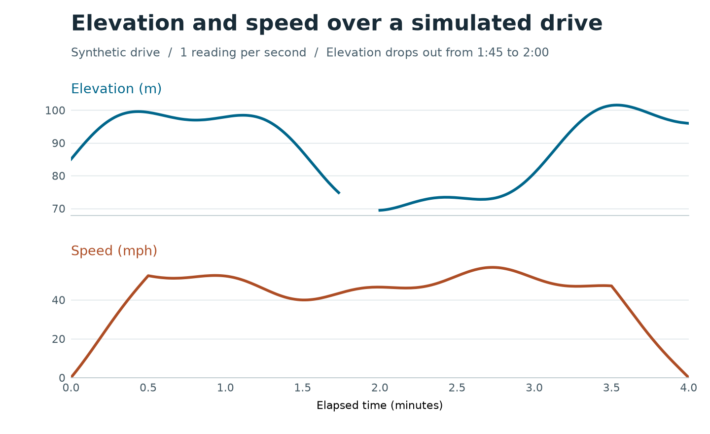

# projectMPG

I built projectMPG to answer a question about my Dallas commute. How does my truck’s fuel use change as the road climbs and traffic slows? My Silverado reports engine airflow through its diagnostic port. A USB GPS receiver supplies position and altitude. I wrote a Python logger to bring those signals together on Linux, then built tools to estimate fuel use and explore individual stretches of a drive.

My project notes cover **12 logged drives, 19,347 readings and approximately 321 miles**. The public demo uses a separate, fictional four-minute drive that anyone can replay on a laptop.

## Try the demo

With Python 3.10+ installed, run these commands in the repository directory on Linux or macOS.

```bash
python3 -m venv .venv
source .venv/bin/activate
python3 -m pip install -r requirements.txt
python3 demo.py
```

The demo prints distance, estimated fuel use, and terrain cues, then writes `demo-output.png`. The included fixture yields **2.84 miles, 0.132 estimated gallons and 21.5 estimated MPG**. The break in the blue trace shows what happens when altitude readings drop out while speed readings continue.



## How it works

- **Logging.** `log_drive.py` reads speed, RPM, load and mass airflow through OBD-II. It parses GPS position and speed from NMEA RMC sentences and altitude from GGA sentences. Pressing Ctrl-C saves the collected readings as a timestamped JSON file.
- **Fuel and distance.** The truck does not report fuel flow directly. The logger estimates gallons per hour from airflow using a 14.7:1 air-to-fuel mass ratio and an assumed gasoline density. The analyzer multiplies each rate by the elapsed time to the next reading, then sums those amounts. It measures distance between GPS fixes using the Haversine formula.
- **Terrain replay.** The coach looks about 15 seconds ahead in a recorded elevation trace. A five-meter rise or fall can trigger a cue above the speed threshold. A smaller three-meter threshold lets the cue persist over small fluctuations. Live route matching and an on-road fuel-savings study are future work.

## Explore a drive

```bash
python3 analyze.py examples/synthetic_drive.json
python3 climb_analysis.py examples/synthetic_drive.json --start 60 --end 120
python3 coach_test.py examples/synthetic_drive.json
python3 plot_elevation.py examples/synthetic_drive.json --output demo-output.png
```

Replace the sample path with one of your own local drive logs to run the same analysis. Use `compare_drives.py file1.json file2.json` to compare sessions. Only the synthetic sample belongs in the public repository.

## Record with the truck hardware

I used an OBDLink LX paired over Bluetooth, a USB GPS receiver and a Linux laptop. Install the hardware dependencies in the same environment with `python3 -m pip install -r requirements-hardware.txt`. Set `OBD_MAC` locally to your paired adapter’s address, then run `bash drive.sh`. The launcher binds the adapter to `/dev/rfcomm0`. You can also use an existing binding by leaving `OBD_MAC` unset. The GPS port defaults to `/dev/ttyACM0` and can be overridden with `GPS_PORT`. Your Linux user needs read/write access to both serial devices.

Start recording while parked. After the drive, stop the logger with Ctrl-C. Local drive files contain precise coordinates and timestamps.

## Limitations and next work

- **Save during capture.** v0.1 buffers readings in memory until a normal stop. Add periodic writes and verify recovery after a simulated power loss.
- **Check the fuel model.** Fixed air-to-fuel assumptions can distort estimates during enrichment or deceleration fuel cut-off. Compare estimated gallons with measured fill-ups over multiple tanks and report the error.
- **Compare real drives.** Add a drive-to-drive summary plot and show coverage gaps alongside the numbers. GPS gaps connect distant fixes with a straight line, and long sampling gaps can distort fuel totals.

The original drive logs stay local. The included chart and sample illustrate the software’s behavior. Actual fuel savings from coaching have yet to be measured.
